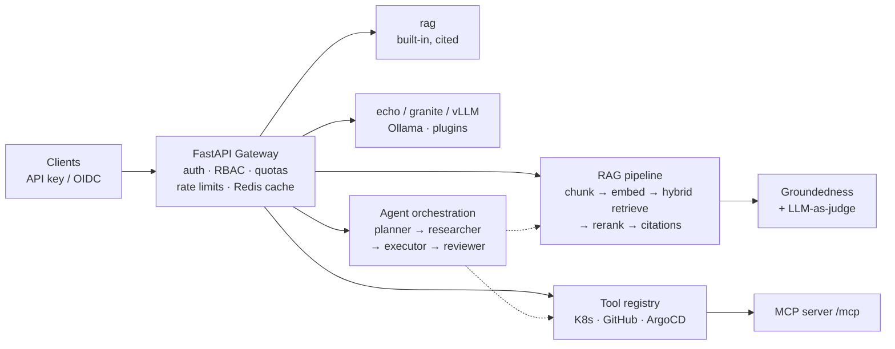

# Goalway

[](https://github.com/aktaseren/goalway/actions/workflows/ci.yml)
[](https://www.python.org/)
[](#tests)
[](https://www.redhat.com/en/technologies/cloud-computing/openshift)
[](LICENSE)

**An enterprise AI gateway — demonstrated on football news.**

Goalway is a production-shaped AI platform: multi-model routing, hybrid RAG
with citations and claim-level hallucination checking, an MCP server, tool
calling, multi-agent orchestration, OIDC auth with per-key quotas, Redis
caching, OpenTelemetry tracing — deployable to OpenShift with one command,
or to any machine with Docker.

The demo theme is football news: real match reports, transfers and awards
are ingested through the RAG pipeline, searched with highlighted citations,
and fact-checked claim by claim — a concrete domain on which every layer of
the architecture is visible.

**⚡ Try it now:** `docker compose up --build` → open **http://localhost:8080/ui**

**📡 Live news:** click **Fetch live news** in the UI (or `POST /v1/news/refresh`, or MCP `tools/call news_fetch`) to pull today's headlines from trusted sources — BBC Sport, Sky Sports and CNN Sport RSS feeds — into the knowledge base. Items are source-tagged and dated, repeated fetches never duplicate, and the recency horizon reflects real publication dates. Sources are configurable via `NEWS_SOURCES`; `NEWS_REFRESH_MINUTES` schedules automatic refresh.



## Demo

### Interactive console (built-in UI)

Goalway serves a self-contained demo console at **`/ui`** — one static
page, no build tooling, talking to the gateway's own APIs:

| Tab | What it shows |
|---|---|
| 💬 Chat | Ask *"Tell me who is last champion in champions league?"* — answered from the knowledge base with citations, freshness disclosure, routing and cache badges, health-aware failover |
| 📚 RAG | **One-click seed of 18 real football articles** or **live fetch from BBC Sport / Sky Sports / CNN Sport**, then hybrid search with **highlighted citation spans**, rerank scores, 👍/👎 feedback |
| 🛡️ Groundedness | Claim-by-claim fact checking — real results show green, fabricated claims ("Barcelona won the final 7-0 on the moon") show red |
| 🔌 MCP | Initialize → list tools → call tools (JSON-RPC 2.0) |
| ⚙️ Admin | API keys, per-key quota meters, model health, hot reload |

```bash
docker compose up --build       # gateway + rag + echo backend + redis
open http://localhost:8080/ui   # demo console → click "Load sample football news"
```

<details>
<summary><b>Try the demo without a UI</b> (curl)</summary>

```bash
# seed the football knowledge base (18 articles)
python3 examples/seed_football.py http://localhost:8080

# chat — answered from the knowledge base, with citations
curl -s localhost:8080/v1/chat/completions \
  -H "X-API-Key: redhat-demo-key" -H "Content-Type: application/json" \
  -d '{"model": "auto", "messages": [{"role": "user", "content": "who is the last champions league winner"}]}'

# RAG search with citations + reranking
curl -s localhost:8080/v1/rag/search -H "X-API-Key: redhat-demo-key" \
  -H "Content-Type: application/json" \
  -d '{"query": "who won the champions league final", "include_stats": true}'

# hallucination detection — the moon-match claim gets flagged
curl -s localhost:8080/v1/rag/groundedness -H "X-API-Key: redhat-demo-key" \
  -H "Content-Type: application/json" \
  -d '{"query": "who won the champions league finals", "answer": "Manchester City beat Inter Milan 1-0 in 2023. Real Madrid beat Dortmund 2-0 in 2024. Barcelona won the 2024 final 7-0 against Bayern Munich, a match played on the moon."}'

# MCP: list the 12 gateway tools
curl -s localhost:8080/mcp -H "X-API-Key: redhat-demo-key" \
  -H "Content-Type: application/json" \
  -d '{"jsonrpc": "2.0", "id": 1, "method": "tools/list"}'
```

Or run the scripted end-to-end demo: `examples/demo.sh`.
</details>

## What's inside

| Area | Capability |
|---|---|
| **Gateway** | OpenAI-compatible chat + streaming, intelligent routing (`model=auto`), health-aware failover, circuit breaker, retries, load balancing, provider plugins (vLLM, Ollama, any OpenAI-compatible server) |
| **RAG** | Document ingest with sentence-aware chunking, pluggable embeddings (Ollama, HuggingFace, TEI, OpenAI-compatible), hybrid retrieval (BM25 + vector + RRF), second-stage reranking (lexical + cross-encoder), citations with exact source spans, metadata filtering |
| **Answer quality** | Built-in extractive QA model with citations and freshness disclosure, relevance gating (honest "not in my knowledge base"), claim-level groundedness/hallucination detection with IDF-weighted support, LLM-as-judge with deterministic fallback, evaluation harness (recall@k, precision@k, MRR, nDCG), user feedback loop |
| **Agents & tools** | Tool registry with JSON-schema validation and RBAC gating — one registry serves OpenAI-style tool calling **and** the MCP server (`POST /mcp`, JSON-RPC 2.0); Kubernetes/OpenShift, GitHub and ArgoCD tools; planner→researcher→executor→reviewer orchestration with per-role metrics |
| **Enterprise** | API keys with roles + per-key quotas (hot-reloadable), OIDC/Keycloak JWT auth via JWKS, RBAC, rate limiting, Redis-backed response cache that degrades gracefully on outage, conversation memory (Redis/PostgreSQL) |
| **Operations** | Prometheus metrics, OpenTelemetry tracing, Grafana dashboards, health/readiness probes, HPA, Helm chart, Tekton pipeline, one-command OpenShift deploy |

## Design notes

- **One tool registry, two protocols.** OpenAI tool calling and MCP are
  both views of the same registry — a new tool is instantly usable by chat
  clients, MCP clients and agents.
- **A cache is an optimization, never a dependency.** Redis outages degrade
  to cache misses (counted in `gateway_cache_errors_total`), never failed
  requests. Redis runs persistence-free: cached responses are disposable.
- **Rerankers must see a candidate pool.** Reranking an already-truncated
  top-k can only reorder; Goalway retrieves `top_k × multiplier` candidates
  and reranks down.
- **Distinctive terms decide groundedness.** Claim support is IDF-weighted:
  names and places dominate over common words, so "Barcelona won on the
  moon" scores 0.21 while true facts score 0.83+.
- **Answers disclose their horizon.** Extractive answers state the
  knowledge base's latest year — an answer that hides its cutoff is a
  hallucination with good manners.
- **Honest no-answers.** Questions outside the knowledge base get "I don't
  have anything about that" instead of marginally-related quotes, gated on
  content-term coverage.

## Deploy to OpenShift

One command (needs `oc` logged in):

```bash
./deploy/deploy.sh                  # builds goalway + echo backend, deploys everything
./deploy/deploy.sh --with-keycloak  # also deploy a demo Keycloak for OIDC
./deploy/deploy.sh --skip-build     # reuse previously built images
```

Includes: BuildConfig builds, ConfigMaps (hot-reloadable model registry +
API keys), PVC for the vector store, Redis, echo model backend (no GPU
needed), HPA (1–5 replicas), Route, optional Keycloak and a Tekton
CI/CD pipeline (`cicd/`).

Or with Helm:

```bash
helm upgrade --install goalway deploy/helm/ -n goalway --create-namespace
```

### Configuration

Key environment variables (see `gateway/config.py` for the full list):

| Variable | Default | Purpose |
|---|---|---|
| `REDIS_URL` | *(empty)* | Shared response cache; empty → in-memory |
| `AUTH_PROVIDERS` | `api_key` | Comma-separated: `oidc,api_key` |
| `OIDC_ISSUER` / `OIDC_AUDIENCE` | *(empty)* | Keycloak realm URL / client audience |
| `API_KEYS_FILE` | `config/api_keys.json` | Key store (roles + quotas) |
| `QUOTA_ENABLED` / `DEFAULT_QUOTA_REQUESTS` | `true` / `1000` | Per-key daily quotas |
| `RAG_RERANKER` | `lexical` | `cross_encoder` needs `CROSS_ENCODER_URL` |
| `TOOLS_ENABLED` / `MCP_ENABLED` | `true` | Tool calling and MCP server |
| `KUBERNETES_API_URL`, `GITHUB_TOKEN`, `ARGOCD_URL/TOKEN` | *(empty)* | Enterprise tool credentials (mount from a Secret) |

## API surface

- `POST /v1/chat/completions` (+ `/stream`) — with `tools` for agentic tool calling
- `POST /v1/rag/ingest`, `POST /v1/rag/search` — citations + rerank + stats
- `POST /v1/rag/evaluate`, `POST /v1/rag/feedback`, `GET /v1/rag/feedback/stats`
- `POST /v1/rag/groundedness` — hallucination detection
- `POST /v1/agents/run` — multi-agent orchestration
- `POST /mcp` — MCP server (initialize / tools/list / tools/call)
- `GET /admin/keys`, `GET /admin/quota`, `POST /admin/reload`
- `GET /health`, `GET /metrics`, `GET /docs` (OpenAPI), `GET /ui` (demo console)

## Tests

```bash
python3 -m venv .venv && .venv/bin/pip install -r requirements.txt -r requirements-dev.txt
.venv/bin/python -m pytest tests/ -q
```

317 tests, fully offline (all HTTP paths mocked). CI runs the suite on
Python 3.12 + 3.13, builds both container images and smoke-tests the
composed stack live.

## License

Apache-2.0
